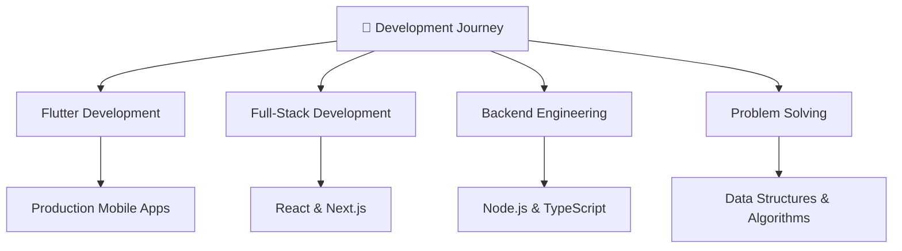

# 👋 Welcome to My Digital Universe!

\<div align="center">   \ \</div>

\<div align="center">   \<h1>     \   \</h1>

&#x20; \<h3>🚀 Flutter Developer | Full-Stack Developer | Kerala, India 🇮🇳\</h3>

&#x20; \<p>     \     \   \</p> \</div>

---

## 🎯 About Me

\

I'm a **Flutter Developer with 2+ years of professional experience** building and shipping cross-platform applications for Android, iOS and Web.

I enjoy working across the development lifecycle — from crafting responsive user interfaces to integrating APIs, implementing authentication, handling payments and deploying backend services.

```javascript
const jasir = {
    name: "Jasir PK",
    location: "Kerala, India 🌴",
    role: "Flutter Developer",
    company: "Tathkarah Travel & Tourism Pvt. Ltd.",

    experience: "2+ Years",

    languages: [
        "Dart",
        "JavaScript",
        "TypeScript",
        "Java",
        "C"
    ],

    frontend: [
        "Flutter",
        "React",
        "Next.js",
        "HTML5",
        "CSS3",
        "Tailwind CSS"
    ],

    backend: [
        "Node.js",
        "Express.js",
        "REST APIs",
        "WebSockets"
    ],

    databaseAndCloud: [
        "Firebase",
        "Firestore",
        "Hive",
        "SQLite",
        "Cloudflare R2"
    ],

    architecture: [
        "Clean Architecture",
        "MVC",
        "DDD",
        "BLoC",
        "GetX",
        "Provider"
    ],

    interests: [
        "Cross-platform Development",
        "Full-Stack Development",
        "API Integration",
        "Cloud Deployment",
        "Open Source"
    ],

    currentlyLearning: [
        "Advanced Flutter",
        "TypeScript",
        "Backend Development",
        "System Design"
    ]
};
```

\<br clear="right"/>

---

## 🛠️ Tech Arsenal

\<div align="center">

### 💻 Languages


\


### 📱 Mobile Development


\


### 🌐 Frontend Development


\


### ⚙️ Backend & Database


\


### ☁️ Tools & Deployment


\


\</div>

---

## 💼 Professional Experience

### Mobile Application Developer (Flutter)

**Tathkarah Travel & Tourism Pvt. Ltd.**

- Developing and maintaining production Flutter applications for Android, iOS and Web.
- Working on a flight and hotel booking platform.
- Integrating payment gateways including TAP Payments, Apple Pay, KNET and MADA.
- Implementing Firebase Authentication, Push Notifications and Crashlytics.
- Building responsive interfaces and supporting English and Arabic RTL localization.
- Integrating REST APIs and WebSocket-based real-time functionality.
- Working with React, Next.js and TypeScript on web application features.
- Handling application releases, debugging and performance optimization.

---

## 🚀 Featured Projects

### ✈️ Tathkarah – Flight & Hotel Booking Platform

- Production travel booking application.
- Cross-platform development using Flutter.
- Integrated multiple payment gateways.
- Firebase authentication and push notifications.
- REST API and real-time communication integrations.

### 🎟️ Event Master – Full-Stack Event Management

- Flutter-based Admin and User applications.
- Backend API built using Node.js, Express.js and TypeScript.
- Firebase Authentication and Firestore.
- Cloudflare R2 image storage using presigned URLs.
- Real-time chat and chatbot functionality.
- Google Maps integration.
- Backend deployed on Render and web admin hosted on Vercel.

### 💪 FitTrack

- Fitness and activity tracking application.
- Flutter-based application development.

### 🌐 Event Master Web Admin

- Web-based event management dashboard.
- Developed using Flutter Web.
- Connected to the Event Master backend API.
- Deployed on Vercel.

---

## 📦 Open Source Contributions

I enjoy building reusable Flutter components and sharing them with the developer community.

| Package                                                                               | Description                                                                 |
| ------------------------------------------------------------------------------------- | --------------------------------------------------------------------------- |
| [flutter_native_battery_level](https://pub.dev/packages/flutter_native_battery_level) | Flutter plugin to retrieve native device battery levels on Android and iOS. |
| [f_multi_select_dropdown](https://pub.dev/packages/f_multi_select_dropdown)           | Reusable multi-select dropdown package for Flutter.                         |

\<div align="center">


\</div>

---

## 📊 GitHub Analytics

\<div align="center">   \   \ \</div>

\<div align="center">   \ \</div>

\<div align="center">   \ \</div>

---

## 🎯 Current Focus

\<div align="center">



\</div>

- 📱 **Building:** Cross-platform mobile applications using Flutter.
- 🌐 **Exploring:** React, Next.js and modern web development.
- ⚙️ **Developing:** REST APIs and backend services with Node.js and TypeScript.
- ☁️ **Working with:** Firebase, Cloudflare R2 and cloud deployment platforms.
- 📚 **Learning:** MCA and strengthening computer science fundamentals.
- 📦 **Contributing:** Publishing and maintaining Flutter packages.
- 💡 **Interested in:** Scalable applications, clean architecture and practical problem-solving.

---

## 🌐 Let's Connect

\<div align="center">


\


\</div>

---

## 💭 Quote of the Day

\<div align="center">

*"The best way to predict the future is to create it."*

**Let's build something amazing together! 🚀**

\</div>

---

\<div align="center">   \ \</div>

\<div align="center">   \<i>⭐️ From \<a href="[https://github.com/jasirpk](https://github.com/jasirpk)">jasirpk\</a> with ❤️\</i> \</div>
