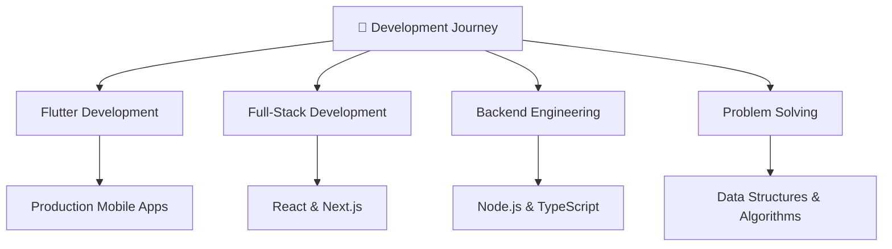

# 👋 Welcome to My Digital Universe!

<div align="center">
  
</div>

<div align="center">
  <h1>
    
  </h1>
  <h3>🚀 Flutter Developer | Full-Stack Developer | Kerala, India 🇮🇳</h3>
  <p>
    
    
  </p>
</div>

---

## 🎯 About Me


I'm a **Flutter Developer with 2+ years of professional experience** building and shipping cross-platform applications for Android, iOS and Web.

I enjoy working across the development lifecycle — from crafting responsive user interfaces to integrating APIs, implementing authentication, handling payment integrations and deploying backend services.

```javascript
const jasir = {
  name: "Jasir PK",
  location: "Kerala, India 🌴",
  role: "Flutter Developer",
  experience: "2+ years",
  languages: ["Dart", "JavaScript", "TypeScript", "Java", "C"],
  frontend: ["Flutter", "React", "Next.js", "HTML5", "CSS3", "Tailwind CSS"],
  backend: ["Node.js", "Express.js", "REST APIs", "WebSockets"],
  databaseAndCloud: ["Firebase", "Firestore", "Hive", "SQLite", "Cloudflare R2"],
  architecture: ["Clean Architecture", "MVC", "DDD", "BLoC", "GetX", "Provider"],
  interests: [
    "Cross-platform Development",
    "Full-Stack Development",
    "API Integration",
    "Cloud Deployment",
    "Open Source"
  ]
};
```

<br clear="right" />

---

## 🛠️ Tech Arsenal

### 💻 Languages

<div align="center">


</div>

### 📱 Mobile Development

<div align="center">


</div>

### 🌐 Frontend Development

<div align="center">


</div>

### ⚙️ Backend & Database

<div align="center">


</div>

### ☁️ Tools & Deployment

<div align="center">


</div>

---

## 💼 Professional Experience

### Mobile Application Developer (Flutter)
**Tathkarah Travel & Tourism Pvt. Ltd.**

- Developing and maintaining production Flutter applications for Android, iOS and Web.
- Working on a flight and hotel booking platform.
- Integrating payment gateways including TAP Payments, Apple Pay, KNET and MADA.
- Implementing Firebase Authentication, Push Notifications and Crashlytics.
- Building responsive interfaces and supporting English and Arabic RTL localization.
- Integrating REST APIs and WebSocket-based real-time functionality.
- Contributing to web application features using React, Next.js and TypeScript.
- Handling application releases, debugging and performance optimization.

---

## 🚀 Featured Projects

### ✈️ Tathkarah – Flight & Hotel Booking Platform

- Production travel booking application.
- Cross-platform development using Flutter.
- Integrated multiple payment gateways.
- Firebase authentication and push notifications.
- REST API and real-time communication integrations.

### 🎟️ Event Master – Full-Stack Event Management

- Flutter-based Admin and User applications.
- Backend API built using Node.js, Express.js and TypeScript.
- Firebase Authentication and Firestore.
- Cloudflare R2 image storage using presigned URLs.
- Real-time chat and chatbot functionality.
- Google Maps integration.
- Backend deployed on Render and web admin hosted on Vercel.

### 💪 FitTrack

- Fitness and activity tracking application.
- Flutter-based application development.

### 🌐 Event Master Web Admin

- Web-based event management dashboard.
- Developed using Flutter Web.
- Connected to the Event Master backend API.
- Deployed on Vercel.

---

## 📦 Open Source Contributions

I enjoy building reusable Flutter components and sharing them with the developer community.

| Package | Description |
| --- | --- |
| [flutter_native_battery_level](https://pub.dev/packages/flutter_native_battery_level) | Flutter plugin to retrieve native device battery levels on Android and iOS. |
| [f_multi_select_dropdown](https://pub.dev/packages/f_multi_select_dropdown) | Reusable multi-select dropdown package for Flutter. |

<div align="center">
  <a href="https://pub.dev/packages/flutter_native_battery_level">
    
  </a>
</div>

---

## 📊 GitHub Analytics

<div align="center">
  
  
</div>

<div align="center">
  
</div>

<div align="center">
  
</div>

---

## 🎯 Current Focus



- 📱 **Building:** Cross-platform mobile applications using Flutter.
- 🌐 **Exploring:** React, Next.js and modern web development.
- ⚙️ **Developing:** REST APIs and backend services with Node.js and TypeScript.
- ☁️ **Working with:** Firebase, Cloudflare R2 and cloud deployment platforms.
- 📚 **Learning:** MCA and strengthening computer science fundamentals.
- 📦 **Contributing:** Publishing and maintaining Flutter packages.
- 💡 **Interested in:** Scalable applications, clean architecture and practical problem-solving.

---

## 🌐 Let's Connect

<div align="center">
  <a href="https://www.linkedin.com/in/jasir-pk-780371286/">
    
  </a>
  <a href="https://github.com/jasirpk">
    
  </a>
  <a href="https://twitter.com/jasir_pk2440">
    
  </a>
  <a href="https://instagram.com/jasirpk_396">
    
  </a>
  <a href="https://www.leetcode.com/jasir-pk">
    
  </a>
  <a href="mailto:jasir.techofficial@gmail.com">
    
  </a>
  <a href="https://pub.dev/packages/flutter_native_battery_level">
    
  </a>
</div>

---

## 💭 Quote of the Day

<div align="center">

*"The best way to predict the future is to create it."*

**Let's build something amazing together! 🚀**

</div>

---

<div align="center">
  
</div>

<div align="center">
  <i>⭐️ From <a href="https://github.com/jasirpk">jasirpk</a> with ❤️</i>
</div>
